# Dark Sky Simulator v2.0

Static, phone-friendly demo of the Dark Sky Simulator for Alachua and Levy counties and their six neighbors
(Marion, Gilchrist, Putnam, Clay, Bradford, Union), built to the v2.0 scope in
[Dark_Sky_Simulator_v2_v3_PRD_TRD.md](Dark_Sky_Simulator_v2_v3_PRD_TRD.md) (Section 0A). It replaces v1's
multiplier heuristics with a Garstang single-scattering skyglow model computed offline, real public data,
seed economics with provenance, an observatory site-selection engine, and a browser-generated legislative brief.

**Every skyglow number is an uncalibrated planning projection.** No sky-quality meter data is used, utility
streetlight counts are modeled, and Bortle classes are labels on a computed magnitude (PRD 0A.5). The app says
so on every screen.

## A tour of the app

Live at [dark-sky-simulator-v2.vercel.app/dark-sky/](https://dark-sky-simulator-v2.vercel.app/dark-sky/). Screenshots are from
the 2026-10-19 build (VIIRS mode) at 1440 × 860 unless noted; they are a snapshot, so retake them after visible changes.
The left panel has seven tabs (Scenario, Sites, Costs, Observatory, Stargaze, AI, Brief); the map on the right follows
the tab, and its layer buttons switch what it shows. How it is built: [Technical architecture](#technical-architecture).

### Lighting scenarios and the map

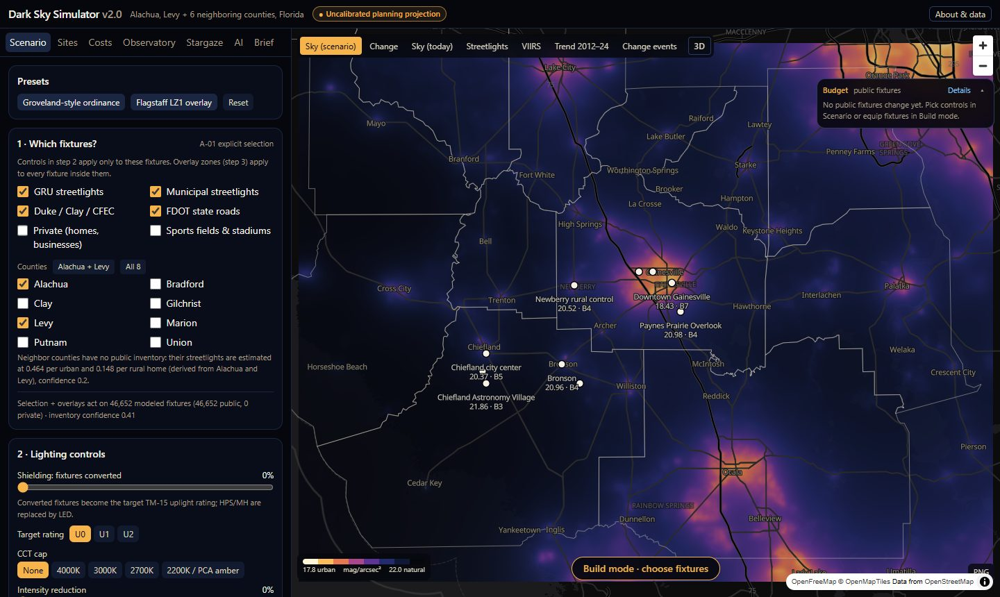

**Scenario tab, *Sky (scenario)* layer.** The panel builds a lighting scenario: which fixtures it applies to (by owner
and county), then the controls. The map shows the modeled zenith sky brightness for that scenario across the eight
counties (mag/arcsec²; yellow is a bright urban sky, dark is close to natural), and the reference sites carry their
magnitude and Bortle class. The amber badge in the header is on every screen: all skyglow values are uncalibrated
planning projections.

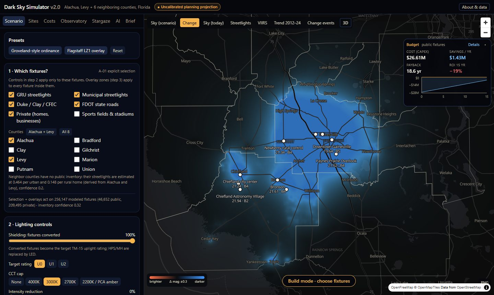

**One-click ordinance and the *Change* layer.** The *Groveland-style ordinance* preset makes every selected fixture
(public and private, Alachua + Levy) fully shielded (U0), caps color temperature at 3000 K and dims to 50% from 22:00
to 06:30. *Change* shows where the sky gets darker (blue) or brighter (red): Paynes Prairie goes from 20.98 to 21.62
mag/arcsec². The **Budget** card on the map prices the public part (here $26.6M capital, $1.43M a year saved, 18.6-year
payback) on the Scenario, Sites, Costs and Brief tabs.

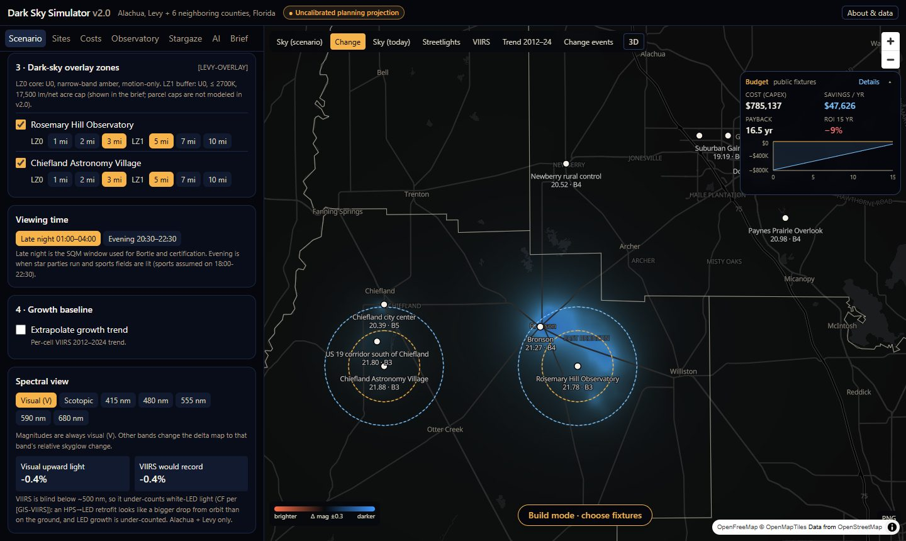

**Dark-sky overlay zones.** Rings around Rosemary Hill Observatory and Chiefland Astronomy Village apply stricter
rules to every fixture inside them, public or private: an LZ0 core (U0, narrow-band amber, motion-only) and an LZ1
buffer (U0, ≤ 2700 K). Shown: the *Flagstaff LZ1 overlay* preset (3-mile core, 5-mile buffer), about $0.79M in public
retrofits.

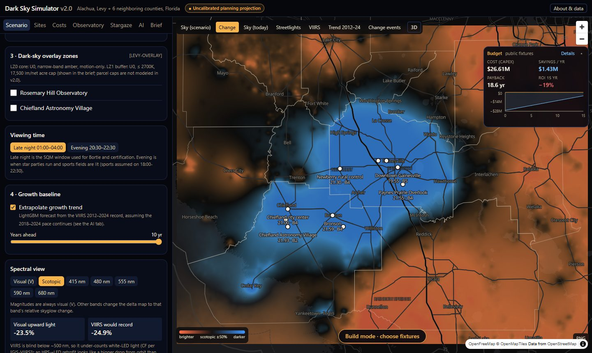

**Viewing time, growth and spectral view.** *Viewing time* switches between the late-night window used for Bortle
classes (01:00–04:00) and the evening (20:30–22:30), when sports fields are lit. *Extrapolate growth trend* adds 1–10
years of growth from the satellite-trained forecast (orange: brighter by 2034 where no ordinance applies). *Spectral
view* redraws the Change layer for one band, here scotopic (night vision), and compares the drop in upward light the
eye would see (−23.5%) with what the VIIRS satellite would record (−24.9%): the satellite barely sees the blue in white
LEDs, so a retrofit looks like a bigger drop from orbit.

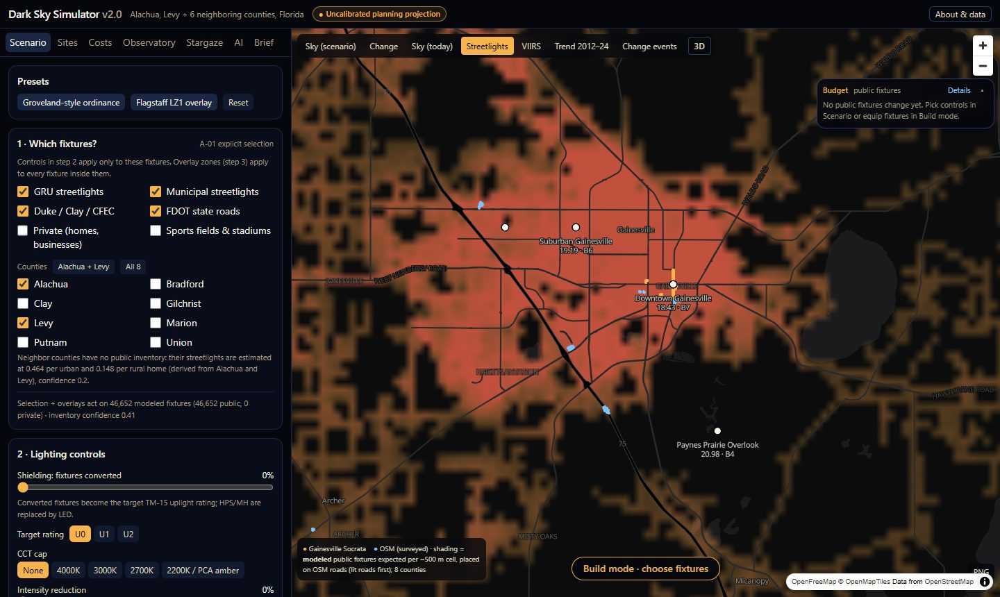

**Streetlights layer.** Where the model puts public streetlights: modeled fixtures per ~500 m cell, placed along
OpenStreetMap roads (roads tagged lit first), and the surveyed points that exist (Gainesville open data in amber,
OpenStreetMap in blue). Shown zoomed into Gainesville.

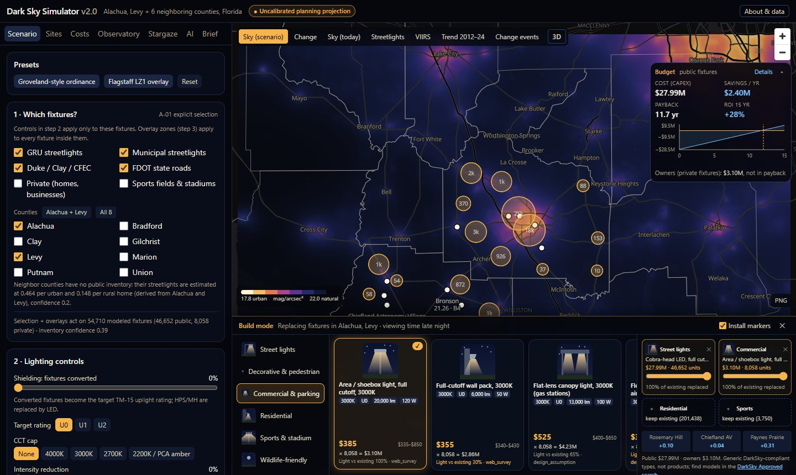

**Build mode.** A catalog of 17 DarkSky-compliant fixture types in six categories, each card with its spectrum,
uplight rating, lumens, watts, installed unit cost (with source) and how many existing fixtures it replaces.
Equipping a card updates the sky, the costs, the brief and the clustered install markers on the map. Shown: a
full-cutoff 2700 K cobra-head for street lights and a shoebox area light for commercial lighting ($28.0M public,
11.7-year payback; the owners' $3.1M for private fixtures is listed separately).

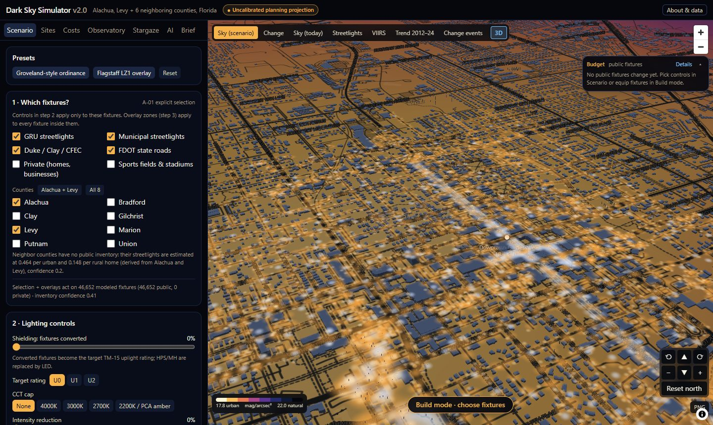

**3D view.** Terrain (×3), buildings and every modeled light source at street level under the sky-brightness map:
mapped streetlights where they stand, modeled ones spread along the roads of their cell, colored by fixture type.
Shown: downtown Gainesville.

### Sites and the night sky

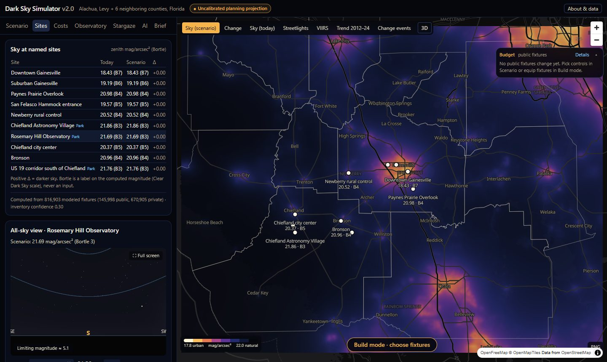

**Sites tab.** Today's and the scenario's zenith brightness at ten reference sites, with Bortle class and the
DarkSky Park tier, and an all-sky view of the selected site.

<p>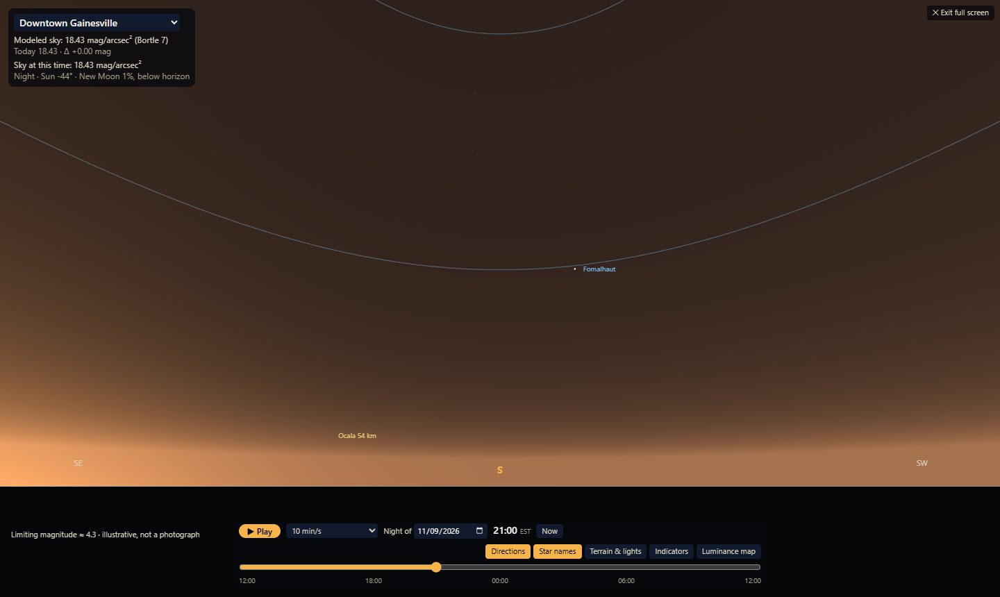 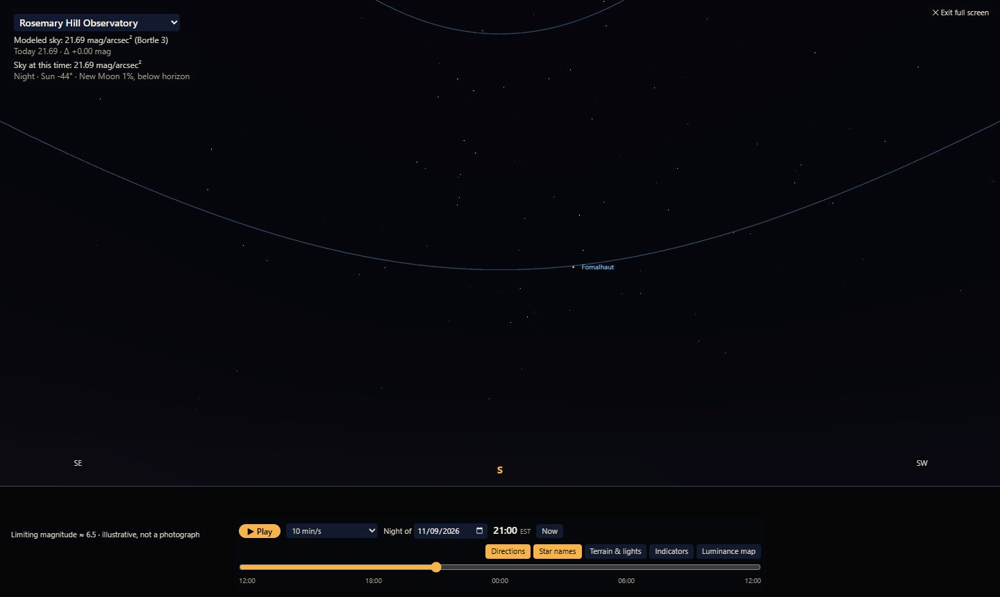</p>

**Full-screen all-sky view**, the same moonless evening (November 9, 2026, 21:00): downtown Gainesville (18.43
mag/arcsec², Bortle 7, naked-eye limit about 4.3, with Ocala's light dome on the horizon) and Rosemary Hill Observatory
(21.69, Bortle 3, limit about 6.5). Stars, Milky Way, Sun and Moon are placed for any date and time; *Play* runs the
night, and toggles add terrain and lights, a sky-glow indicator and a false-color luminance map. Illustrative, not a
photograph.

### Costs

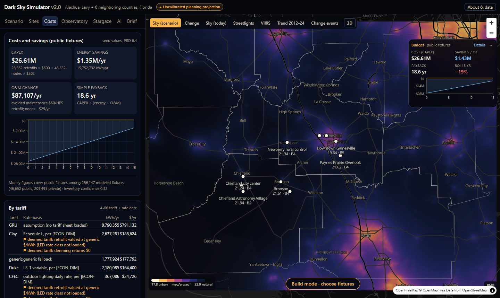

**Costs tab** for the Groveland-style scenario: capital cost (retrofits × unit price + dimming nodes), yearly energy and
maintenance savings, simple payback, the 15-year cumulative cash position, and each utility's tariff with its rate
basis; lines without a loaded tariff are flagged.

### Observatory siting

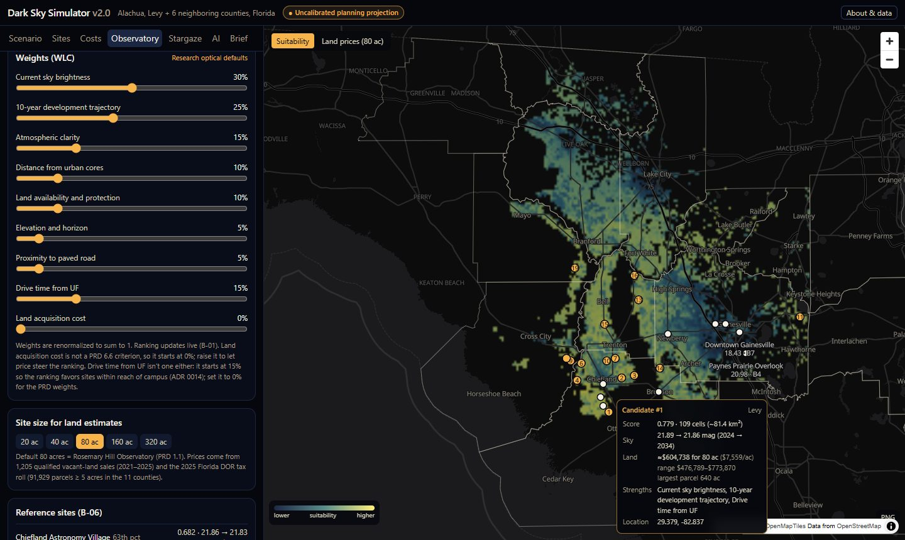

**Observatory tab.** Scores every ~1 km cell of an 11-county region for a new research observatory with a weighted sum
of criteria whose weights you set (current sky, 10-year development, clarity, distance from cities, land availability,
elevation, road access, land cost). The top 20 sites of at least four contiguous cells are listed and mapped, with
Rosemary Hill and Chiefland as reference rows. Hovering a candidate shows its score, 2024 → 2034 sky, land estimate and
strengths; here #1, in Lafayette County, on 92% state land.

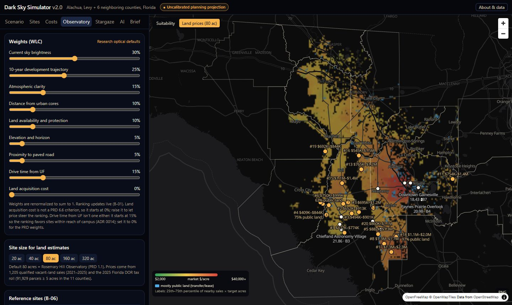

**Land prices.** Market $/acre from 1,205 qualified vacant-land sales (2021–2025) and the 2025 Florida tax roll, public
land in blue, and each candidate's price range for an 80-acre site.

### Stargazing tonight

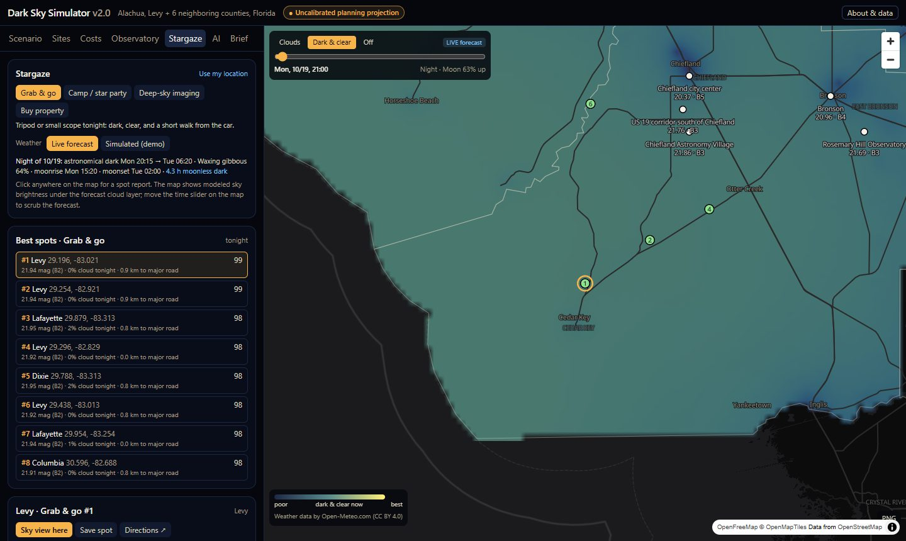

**Stargaze tab.** The live Open-Meteo forecast over the modeled sky: *Dark & clear* combines darkness with forecast cloud
for the hour on the slider, and *Best spots* ranks places for a use case (grab & go, star party, deep-sky imaging,
buying property).

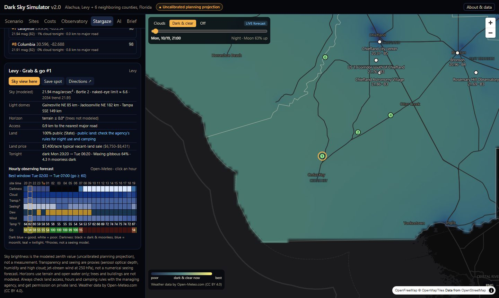

**Spot report** (pick a spot, or click anywhere on the map): modeled sky, light domes by direction, horizon, road access,
land ownership and price, tonight's darkness and Moon, and an hourly observing forecast (darkness, cloud, transparency
and seeing proxies, dew, wind) with the best window.

### Satellite data and the AI

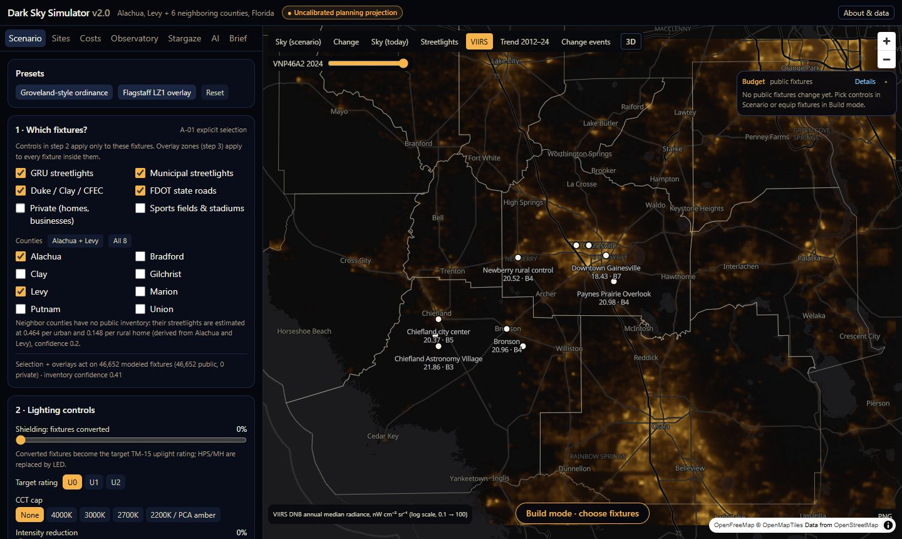

**VIIRS layer.** NASA Black Marble (VNP46A2) yearly median radiance of cloud-free nights, 2012–2024, with the airglow
background removed; the slider steps through the years.

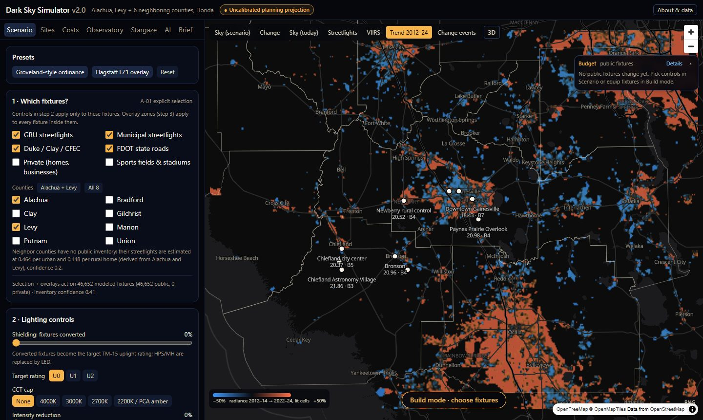

**Trend 2012–24.** Change in radiance from 2012–14 to 2022–24, for cells lit at either end: growth along I-75 and
around Ocala, declines in some older cores.

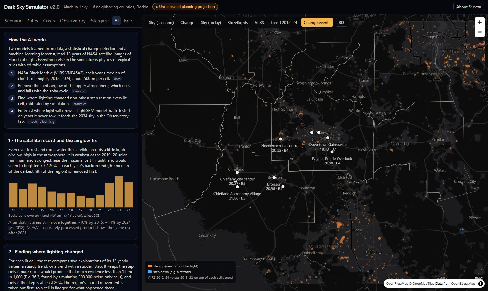

**AI tab.** What is learned from data (a statistical change detector and a LightGBM forecast) and what is not, starting
with the satellite record and its airglow correction (the background glow by year). The map switches to *Change
events*. See [ADR 0011](docs/adr/0011-viirs-first-run.md) and [ADR 0012](docs/adr/0012-step-test-and-ai-tab.md).

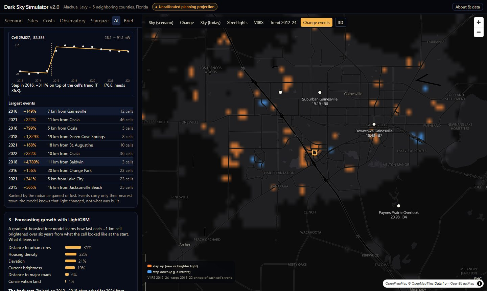

**Change events and the cell inspector.** Each lit cell is tested for a sudden step on top of its trend (false alarms 1
in 1,000, calibrated by simulation). Clicking an event or any cell shows its 13 yearly values, the fitted line or step,
and why it was or was not flagged; shown: the Celebration Pointe area, +311% in 2016.

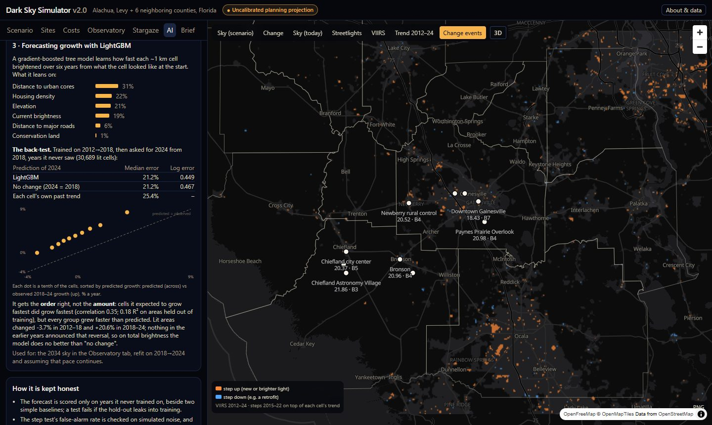

**The growth forecast, back-tested.** What the LightGBM model relies on, its error on years it never saw next to "no
change" and each cell's own trend, and predicted vs observed growth by tenth of cells: it gets the order right but not the
amount, because lit areas fell 3.7% in 2012–18 and rose 20.6% in 2018–24.

### The brief and the fine print

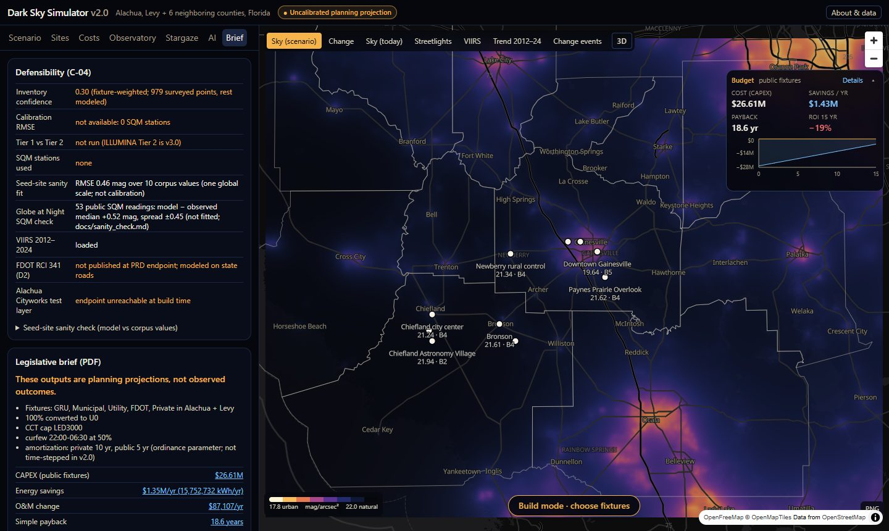

**Brief tab.** The defensibility panel lists what the numbers rest on and what is missing (calibration stations, utility
inventories). The legislative brief summarizes the scenario and downloads as a PDF that opens with "These outputs are
planning projections, not observed outcomes", with every figure linked back to the scenario field it came from.

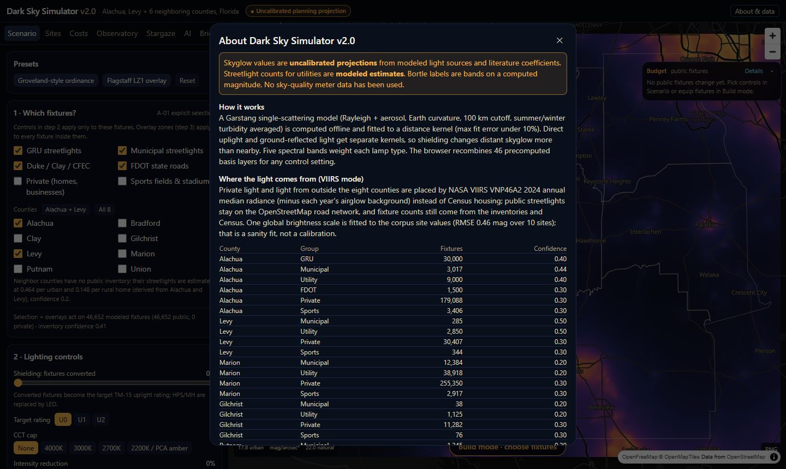

**About & data.** How the model works, where the light comes from, and the fixture inventory by county and owner with
its confidence.

### On a phone

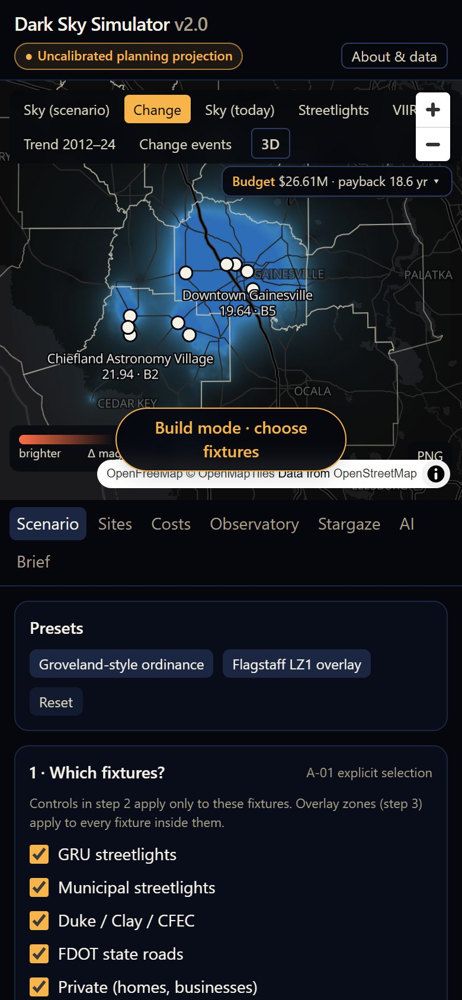

The same app on a 390 px phone screen (shown at 2×): map on top, panels below.

## Quick start

```bash
# Python 3.12 pipeline (uv or any venv)
python -m uv venv --python 3.12 .venv
python -m uv pip install --python .venv -e ".[dev,ml,viirs]"
.venv/Scripts/python -m pipeline.ingest_all      # pull public sources into data_raw/ (cached)
.venv/Scripts/python -m pipeline.build           # precompute web/public/dark-sky/data/ and docs/sanity_check.md
.venv/Scripts/python -m pytest                   # 79 tests (53 Dark Sky, 5 WildSight, 21 Public Art; 1 skips until florida_budgets.yaml exists)

# Web client
cd web
npm install
npm run dev        # http://localhost:5173 (homepage); Dark Sky at /dark-sky/, /wildsight/, /public-art/
npm test           # Vitest: requirement-ID acceptance tests
npm run build      # static site in web/dist (relative paths; host under any sub-path)
```

### VIIRS (Earth Engine)

The PRD's satellite baseline (NASA Black Marble VNP46A2, 2012–2024) comes from Google Earth Engine through Jay's
personal Cloud project `dark-sky-simulator` (noncommercial Community tier). It was first pulled on 2026-10-19, and
the current package runs in **VIIRS mode** (below). To refresh, or on a new machine:

```bash
.venv/Scripts/earthengine authenticate
.venv/Scripts/python -m pipeline.ingest_all --viirs --ee-project dark-sky-simulator
.venv/Scripts/python -m pipeline.build
```

The build switches to VIIRS mode whenever every year is cached: each year's airglow background is removed,
private light is placed by 2024 radiance, the VIIRS year slider, 2012–2024 trend map and change-event map appear,
and 10-year growth comes from the LightGBM forecast. The **AI tab** explains both models with their checks (change
events with a cell inspector, the forecast's back-test against "no change"). The first real run found a double
scaling bug, the solar-cycle airglow and a back-test that flattered the model ([ADR 0011](docs/adr/0011-viirs-first-run.md));
the step detector was then rebuilt ([ADR 0012](docs/adr/0012-step-test-and-ai-tab.md)).

## What is in the demo (PRD 0A.2 v2.0 column)

| Module | v2.0 requirement | Where | Test |
| --- | --- | --- | --- |
| A | A-01 controls apply only to an explicit fixture selection | Scenario tab, step 1 | `test_A_01_*` |
| A | A-02 every panel shows fixture count and inventory confidence | all output panels | `test_A_02_*` |
| A | A-07 Bortle never shown without its magnitude | Sites tab, map labels, brief | `test_A_07_*` |
| A | A-08 PDF opens with the planning-projection sentence and confidence | Brief tab | `test_A_08_*` |
| B | B-01 top-20 sites from ≥ 4 contiguous cells, live weights | Observatory tab | `test_B_01_*` |
| B | B-02 per-site scorecard (raw, score, weight, contribution) | Observatory tab | `test_B_02_*` |
| B | B-06 RHO and CAV always scored as reference rows | Observatory tab | `test_B_06_*` |
| B | simplified B-03: 2034 magnitude from the growth trend | Observatory tab | – |
| – | How the AI works: change events, cell inspector, forecast back-test (added on request) | AI tab | `changes.test.ts`, `test_ml.py` |
| C | C-01 every PDF figure hyperlinks to its scenario field | Brief tab / PDF | `test_C_01_*` |
| C | C-04 defensibility panel | Brief tab | `test_C_04_*` |

**Build mode** (button at the bottom of the map): a SimCity-style tray with 17 DarkSky-compliant fixture types in
six categories (street, decorative & pedestrian, commercial & parking, residential, sports & stadium,
wildlife-friendly). Each card shows a drawn thumbnail, spectrum, U-rating, lumens, watts, an installed unit cost
with its source, how many existing fixtures it replaces in the selected counties, and the total. Equipping a card
updates the sky, costs and brief, and puts clustered install markers on the map ([ADR 0007](docs/adr/0007-build-mode-catalog-sports.md)).
A **viewing-time** switch shows the late-night SQM window (default) or the evening (20:30–22:30), when the new
**sports-lighting source** (OSM fields, courts and stadiums, ~9,200 modeled fixtures) is on.
The **Observatory** tab prices land for every candidate from the Florida DOR 2025 tax roll and recorded sales:
market and tax-roll estimates for a chosen site size, public/private ownership, the largest parcel and the value of
existing buildings ([ADR 0006](docs/adr/0006-land-pricing.md)). A *Land prices* map toggle swaps the suitability
heatmap for a market $/acre surface (mostly-public land in blue) and labels each candidate with its price range;
hovering a candidate shows its score, sky, land and location.
**Stargaze** tab for astronomers, astrophotographers, campers and land buyers: pick a use (grab & go, camp /
star party, deep-sky imaging, buy property) for ranked spots; a live cloud forecast (or a labeled simulation) and a
"dark & clear" layer on the map with an hour slider; click anywhere for a spot report (sky, light domes, horizon,
access, ownership, land price, tonight's darkness and Moon, an hourly Clear-Sky-Chart-style forecast with
transparency/seeing proxies and dew risk), a sky view at that spot, saved spots and directions ([ADR 0008](docs/adr/0008-stargaze-mode.md)).
**3D** (button on the map): terrain, extruded buildings and the light sources as poles with glowing, color-coded
heads and light pools: mapped streetlights where they stand, modeled ones spread along the roads of their cell,
sports towers at real venues; equipped cards recolor their share. In the Sites sky view, **Terrain & lights** puts the
same scene under the stars (eye height 2 m to 600 m), and **Indicators** / **Luminance map** add a sky-glow curve,
a luminance readout (mag/arcsec², mcd/m²) and a false-color sky ([ADR 0009](docs/adr/0009-3d-terrain-lights-skyglow.md)).
A **Budget** readout on the map (Scenario, Sites, Costs and Brief tabs) keeps public cost, yearly savings, payback, 15-year ROI
and a cumulative cash chart in view for the current scenario; it collapses to one line and links to the Costs tab.

Also shipped: the A-06 tariff and rate date on every money line, the Groveland-style ordinance preset (A-04 is
v3.0, but the preset drives the AI Days headline), five-band spectral view with scotopic mode, a VIIRS vs visual
readout showing DNB blue-blindness, Levy dark-sky overlay rings (LZ0/LZ1 per [LEVY-OVERLAY]), a 10-year growth
toggle, shareable scenario URLs, PNG map export, and a Three.js all-sky view driven by the computed zenith value
(full-screen mode with a site picker; stars, Milky Way, Sun and Moon placed for any date and site time, with
twilight and moonlight added (Krisciunas & Schaefer 1991); compass, altitude-ring, light-dome and star-name overlays;
autoplay in full screen).

Headline projections (VIIRS mode, build of 2026-10-19, uncalibrated; zenith mag/arcsec², higher is darker):

| Scenario (Alachua + Levy unless noted) | Paynes Prairie | RHO | CAV | Public CAPEX | Payback |
| --- | --- | --- | --- | --- | --- |
| Today (model, late night) | 20.98 | 21.69 | 21.86 | – | – |
| All public fixtures U0 + 3000K | 21.20 | 21.77 | 21.89 | $17.2M | 7.4 yr |
| Groveland-style, public only | 21.30 | 21.80 | 21.89 | $26.6M | 18.6 yr |
| Groveland-style, public + private | 21.62 | 21.88 | 21.94 | $26.6M (public) | 18.6 yr |
| Groveland-style, public + private, all 8 counties | 21.65 | 21.91 | 21.96 | $98.9M (public) | 17.0 yr |
| Levy overlays (LZ0 2 mi, LZ1 5 mi) around RHO and CAV | 20.98 | 21.77 | 21.88 | $0.75M | 13.6 yr |
| Marion public fixtures U0 + 3000K (alone) | 20.98 | 21.70 | 21.86 | $30.8M | 9.2 yr |
| Today, evening (20:30–22:30) | 20.56 | 21.58 | 21.79 | – | – |
| Evening, all sports fixtures → LED 3000K with visors, 8 counties | 20.76 | 21.65 | 21.83 | $75.8M | – |

Cross-checks against the corpus: the public-only retrofit gives Paynes Prairie +0.22 mag (the Gainesville
assessment [GNV-ASSESS] predicted +0.2 to +0.4), and the Levy public retrofit CAPEX of $1.88M matches
[ECON-RETRO]'s median. The Groveland payback is long because dimming needs a $202 smart node on every public
fixture, and Clay/CFEC deemed tariffs earn nothing from dimming.

## How it works

```
data_raw/ (cached public pulls) ─┐
seed/  (PRD 6 constants)        ─┼─> pipeline/build.py ──> web/public/dark-sky/data/ ──> web/ (static React + MapLibre)
counties/ (data packages)       ─┘        │
engine/ (pure physics) ◄──────────────────┘
```

- **engine/**: Garstang single-scattering integral (Rayleigh + Henyey-Greenstein aerosol, slant extinction,
  Earth curvature, summer/winter turbidity), separate direct-uplight (θ⁴) and ground-reflected kernels fitted
  within 7.4% of the numeric curve, five-band spectral factors from the seed SPD table, Bortle mapping, MCDA
  normalizations. No I/O, no county imports (enforced by `test_engine_imports_nothing_county_specific`).
- **ingest/**: connectors for Census TIGERweb (block groups, places, county subdivisions, roads), Gainesville
  Socrata, OSM Overpass, FDOT RCI (layer discovery), Alachua Cityworks, USGS 3DEP, FNAI conservation lands,
  Globe at Night, and Earth Engine VNP46A2.
- **pipeline/build.py**: places fixture stocks, splits them into 38 components (group × county outside the
  overlays, 6 rings each around RHO and CAV, and external sources), convolves each with both kernels, and writes
  per-unit basis layers. The browser multiplies each layer by the scenario's effective flux, so any control
  combination renders in about 55 ms (measured in the dev build).
- **web/**: Vite + React 18 + TypeScript + Tailwind, MapLibre GL on OpenFreeMap tiles, Zustand, Recharts, jsPDF,
  Three.js.

### VIIRS mode (current package)

Public streetlights are placed on the OpenStreetMap road network (roads tagged `lit=yes` count fully; other roads
in proportion to Census housing density), using the PRD 6.5 counts by owner for Alachua and Levy. The six neighbors
have no public inventory anywhere, so their public counts come from rates derived from Alachua and Levy (0.464
fixtures per urban home, 0.148 per rural home, confidence 0.2). Private light, and light from outside the eight
counties, follows 2024 VIIRS radiance (Census 2020 housing in seed mode, used when the VIIRS cache is absent). One
global flux scale is fitted to the ten corpus site magnitudes (RMSE 0.46 mag; 0.52 in seed mode); that is a sanity
fit, not calibration. Against 53 public Globe at Night **SQM** readings never used in any fit, the median
model − observed residual is +0.52 mag (±0.45; seed mode +0.48): the model reads somewhat dark. For the 11 readings
taken after midnight it is +0.21 mag. See
[docs/sanity_check.md](docs/sanity_check.md).

## Technical architecture

Two halves: an offline Python pipeline turns public data into a static data package, and a browser app recombines
that package for any scenario without a server. The diagrams follow the code in `ingest/`, `engine/`, `pipeline/`,
`ml/` and `web/src/`.

### 1. System overview

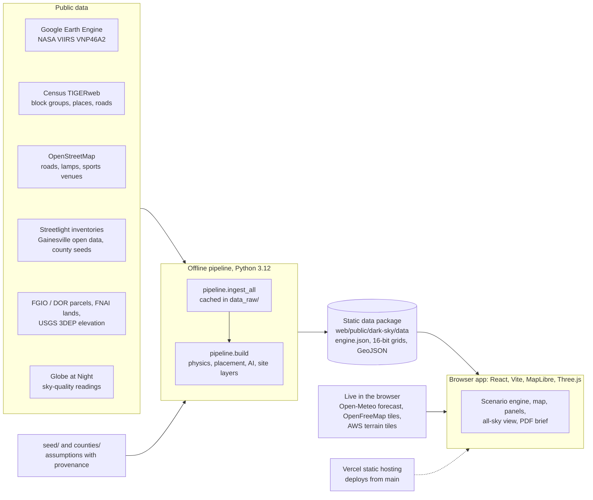

Everything heavy (scattering integrals, convolutions, satellite processing, model training) runs once offline. The
browser only loads the package and does weighted sums, so a phone can explore any scenario instantly.

### 2. Build pipeline (`python -m pipeline.build`)

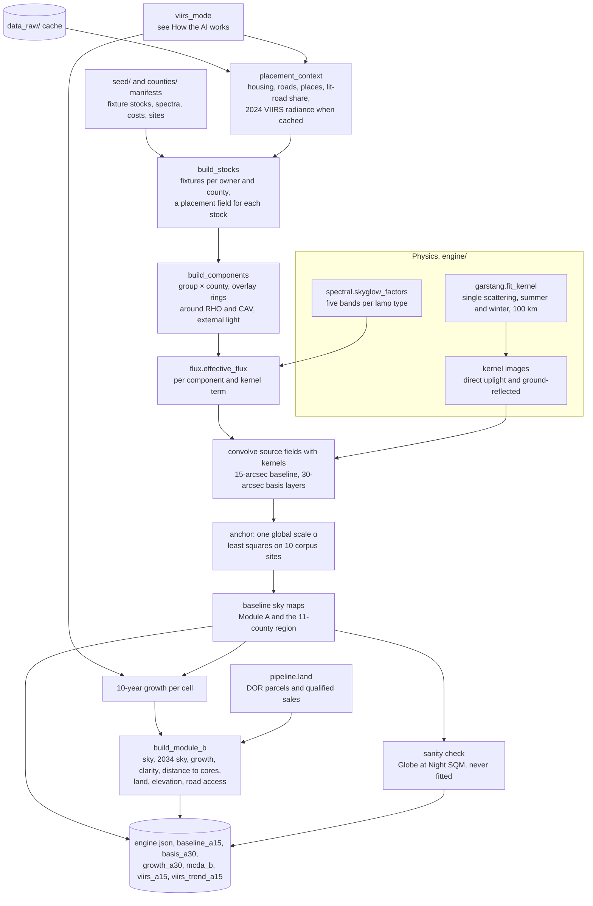

Each component (a fixture group in one county, a ring of an overlay zone, or the light from outside the eight
counties) gets one basis layer per kernel term. Controls in the browser change only how much flux each component
emits, so the sky for any scenario is a weighted sum of these precomputed layers.

### 3. Skyglow physics: from a fixture to a magnitude

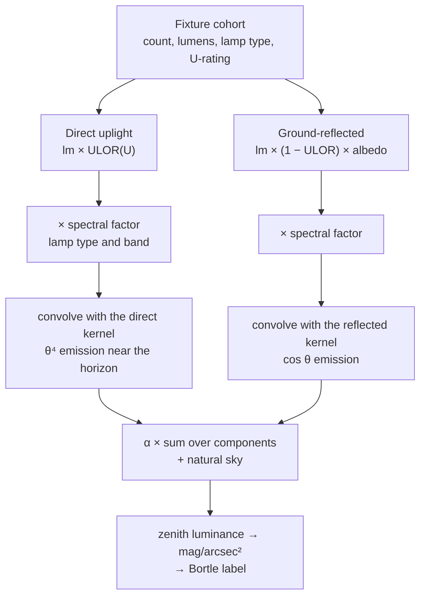

The kernels come from a Garstang single-scattering integral (Rayleigh and Henyey-Greenstein aerosol scattering,
slant-path extinction, Earth curvature), fitted to an analytic curve. Direct uplight leaves mostly near the horizon
(the θ⁴ term) and travels far, which is why shielding matters most for distant skies. The global scale α is a sanity
fit to ten corpus site values, not a calibration.

### 4. Browser runtime: what happens when you move a control

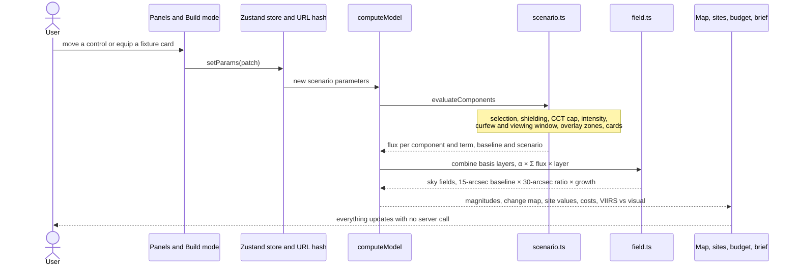

The same pure functions run in the tests: a Vitest case checks that the browser's baseline flux equals the
pipeline's `engine/flux.py` for every component, and the scenario lives in the URL so any view can be shared or
linked from the PDF brief.

### 5. Observatory siting and Stargaze

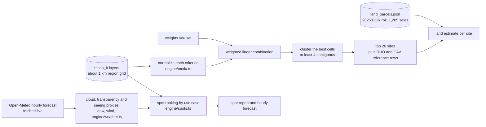

Site ranking is a transparent weighted sum, not machine learning; its development-trajectory criterion and its
2034 sky column come from the growth forecast below.

### 6. How the AI works: satellite data to models

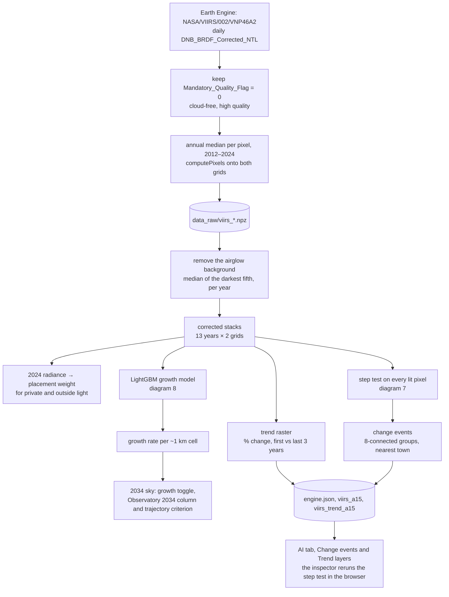

Two models learn from data: a statistical change detector and a LightGBM forecast. Airglow, the faint light of the
upper atmosphere, follows the solar cycle (0.10 nW at the 2019–20 minimum, 0.33 nW in 2023); removing it first keeps
forests and wetlands from appearing to brighten ([ADR 0011](docs/adr/0011-viirs-first-run.md)).

### 7. The step test for one pixel (`ml/trends.py`)

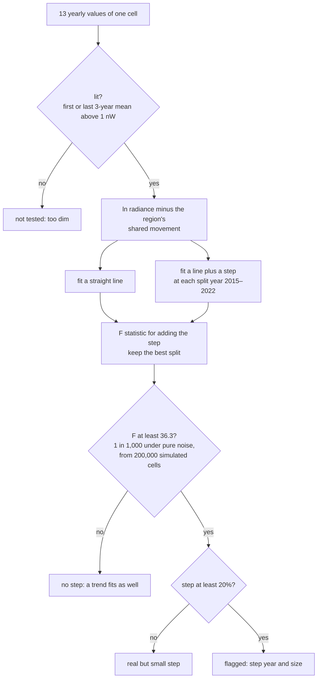

Choosing the best of eight split years inflates an ordinary F test, so the cutoff comes from simulating noise-only
series; the statistic does not depend on the line or the noise level, so one simulation serves every pixel. At the
real year-to-year scatter (about 10%), large new lighting is found and most 20–40% retrofit drops are not
([ADR 0012](docs/adr/0012-step-test-and-ai-tab.md)).

### 8. The growth forecast and its back-test (`ml/growth.py`)

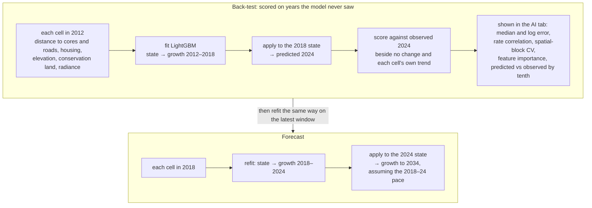

In this build the model matches "no change" on total brightness (21.2% median error each) because lit areas fell
3.7% in 2012–18 and rose 20.6% in 2018–24, a reversal nothing in the earlier years predicted. It does rank where
growth concentrates (correlation 0.35), the part that matters when comparing candidate sites.

### 9. How the models are checked

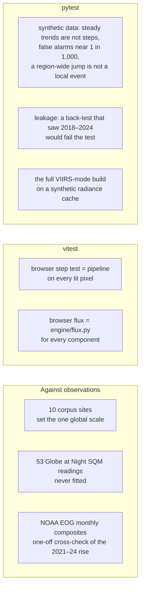

## Data reality check (2026-09-26)

| Source (PRD 7) | Status |
| --- | --- |
| VIIRS VNP46A2 via Earth Engine | pulled 2026-10-19: 2012–2024 annual medians on both grids, 180+ clear nights per pixel per year; airglow background removed ([ADR 0011](docs/adr/0011-viirs-first-run.md)) |
| FDOT RCI Feature 341, District 2 | **no longer published** at the PRD endpoint; the statewide lighting points cover District 5 only. The FDOT count is spread along TIGER state roads (confidence 0.3) |
| Gainesville Socrata `tk33-9jw3` | 267 points |
| Alachua Cityworks test layer | endpoint timed out on every attempt |
| OSM street lamps | 744 nodes across the eight-county grid (PRD expected 20–40k for Alachua alone) |
| OSM roads | 88,957 public road segments, 2,494 tagged `lit=yes`; used to place modeled streetlights |
| Neighbor-county inventories | none public (no county/city streetlight service found; FDOT's public lighting layer covers two Orlando-area counties) |
| OSM sports venues | 2,304 candidates; 1,229 modeled inside the eight counties (lit-tagged, stadiums, untagged at 50%) |
| Florida DOR 2025 parcels (FGIO statewide centroids) | 91,929 parcels ≥ 5 acres in the 11 region counties; 1,205 qualified vacant-land sales 2021–2025 |
| DarkSky Approved luminaires | searchable list only, no prices or data feed; cards are generic types that link to it |
| AWS Terrain Tiles (3D terrain, live in the browser) | Terrarium DEM tiles (USGS 3DEP and other public DEMs), no key |
| OpenFreeMap / OpenMapTiles buildings and roads (3D, live) | building heights (`render_height`); roads carry modeled lamp positions |
| Open-Meteo forecast + air quality (Stargaze, live in the browser) | hourly cloud (0.2° grid), humidity, dew point, wind, 250 hPa wind, aerosol optical depth; CC BY 4.0, free for non-commercial use |
| Census | TIGERweb 2020 counts (the ACS API now needs a key, so the private stock uses the Alachua structure blend, 1.379 fixtures per housing unit) |
| 3DEP, FNAI, Globe at Night | pulled |

## Deviations from the PRD (with reasons)

See [docs/adr/](docs/adr/). In short:
1. Raster layers ship as compact 16-bit binary grids, not PMTiles, because the browser needs numeric values to combine basis layers. Surveyed fixtures ship as GeoJSON (fewer than 700 points). ([ADR 0001](docs/adr/0001-basis-layers-as-binary-grids.md))
2. Seed-mode emission: streetlights on the OSM road network, private light on Census housing, neighbor counts from derived rates, anchored to corpus site values. ([ADR 0002](docs/adr/0002-seed-mode-emission.md))
3. Band fractions stand for spectral chunks; spectral effects are per-SPD scalars on one spatial kernel. ([ADR 0003](docs/adr/0003-spectral-chunks.md))
4. Module B proxies until parcels, MODIS and VIIRS load; Section 3's "within 3 km scores 1" wins over the 6.6 access anchor. ([ADR 0004](docs/adr/0004-module-b-proxies.md))
5. Lighter Python stack: NumPy/SciPy/Shapely/tifffile instead of GeoPandas/rasterio/rio-pmtiles/tippecanoe. ([ADR 0005](docs/adr/0005-python-stack.md))
6. Land and facility pricing from the DOR tax roll and recorded sales; land-cost criterion at weight 0 by default. ([ADR 0006](docs/adr/0006-land-pricing.md))
7. Build mode catalog, sports lighting source, and evening viewing time (not PRD requirements; added on request). ([ADR 0007](docs/adr/0007-build-mode-catalog-sports.md))
8. Stargaze mode with live Open-Meteo weather (not a PRD requirement; added on request). ([ADR 0008](docs/adr/0008-stargaze-mode.md))
9. 3D terrain, light-source structures, Sites ground view and sky-glow indicators (added on request). ([ADR 0009](docs/adr/0009-3d-terrain-lights-skyglow.md))
10. WildSight Planner, a separate app on the same platform (added on request): see [wildsight/README.md](wildsight/README.md).
11. Public Art Policy Simulator, a third app on the same platform (added on request): see [publicart/README.md](publicart/README.md).
12. A homepage at the site root for the three apps; the Dark Sky Simulator moved to `/dark-sky/`, and old `/#s=…` links are forwarded. ([ADR 0010](docs/adr/0010-homepage-and-dark-sky-path.md))
13. VIIRS first run: no double scaling, a per-year airglow background removed, and a growth back-test scored against "no change". ([ADR 0011](docs/adr/0011-viirs-first-run.md))
14. Change events from a step-versus-trend test calibrated by simulation, and an AI tab that explains both models (added on request). ([ADR 0012](docs/adr/0012-step-test-and-ai-tab.md))

Not built (v2.0 stretch): the YOLOv8 luminaire detector on Mapillary imagery for US 441.

## Open items that need Jay (PRD 0B, plus new ones)

- The County's +19% Alachua radiance growth (2012–2024) [AC-EPAC] is not reproduced by VNP46A2 (+3.0%, first vs last three years); find out which product and method the County used before quoting it.
- The step test finds large new lighting but, at about 10% year-to-year noise, misses most retrofits; detecting those needs monthly data or utility work-order records ([ADR 0012](docs/adr/0012-step-test-and-ai-tab.md)).
- Confirm RHO's county and verify every approximate coordinate in 6.5 (they drive the sanity fit).
- Census API key (free) would restore the ACS structure-type split for the private stock.
- Ask FDOT District 2 where Feature 341 now lives, and Alachua County GIS about the Cityworks endpoint.
- Levy owner split for the 2,850 unincorporated fixtures (tariffs currently split equally).
- Choose the host path (jayrosen.design/dark-sky/v2 or GitHub Pages). The build is static with relative paths; `.github/workflows/pages.yml` deploys `web/dist` once this folder is a GitHub repository.

## Layout

A homepage (`/`, `web/index.html`) and three apps share this repository, build and deployment: the Dark Sky
Simulator (`/dark-sky/`), [WildSight](wildsight/README.md) (`/wildsight/`, roadside wildlife-detection planning) and
the [Public Art Policy Simulator](publicart/README.md) (`/public-art/`, Chapter 5.5 Art in Public Places planning).
They share the mapping core, astronomy and UI (`web/src/shared`) and the backend plumbing (`ingest/`,
`counties/region`); no app imports another's code.

```
engine/    pure physics (Garstang kernel, spectral, Bortle, MCDA, flux)
ingest/    public-data connectors, shared by the apps (cache to data_raw/, git-ignored)
pipeline/  ingest_all, build, VIIRS mode, sanity check, encoders
ml/        VIIRS trend + step-change detector, LightGBM growth model
seed/      PRD Section 6 constants with provenance
counties/  12001 and 12075 data packages, region + grids
web/       homepage and React clients; web/public/<app>/data are the data packages, web/src/shared the shared platform
wildsight/ WildSight Planner pipeline, config, tests and docs (its web app is web/src/wildsight)
publicart/ Public Art Policy Simulator pipeline, registry, capital program, assumptions, tests and docs (web/src/publicart)
tests/     pytest (engine, contracts, ML, VIIRS-mode build)
docs/      ADRs, sanity check, demo script, v3.0 funding one-pager
```
